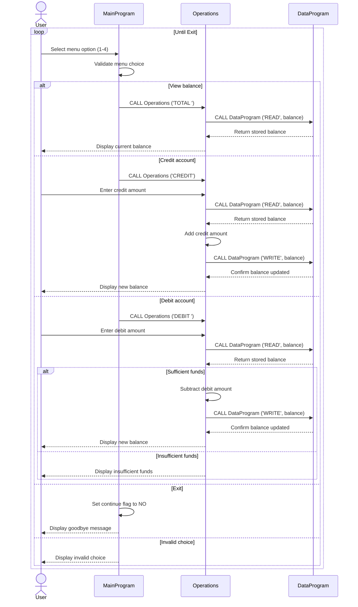

# School Student Account COBOL System

This directory documents the legacy COBOL application in `src/cobol`. The application provides a simple account-management menu for viewing, crediting, and debiting a student's account balance.

## COBOL programs

### `main.cob`

**Program:** `MainProgram`

The entry point and user-interface layer. It displays the account-management menu, accepts a numeric menu choice, and calls `Operations` with a padded operation code.

Key functions:

- `1` - display the current balance through the `TOTAL ` operation.
- `2` - credit the account through the `CREDIT` operation.
- `3` - debit the account through the `DEBIT ` operation.
- `4` - set the continue flag to `NO` and exit.
- Invalid choices display an error and return to the menu.

### `operations.cob`

**Program:** `Operations`

The business-operation layer. It receives an operation code, reads and updates the balance through `DataProgram`, and displays operation results.

Key functions:

- `TOTAL ` - reads the balance and displays it.
- `CREDIT` - accepts a credit amount, reads the current balance, adds the amount, and writes the new balance.
- `DEBIT ` - accepts a debit amount, reads the current balance, and subtracts it only when sufficient funds are available.

### `data.cob`

**Program:** `DataProgram`

The data-access layer for the in-process account balance. It accepts `READ` or `WRITE` operations and copies the balance to or from `STORAGE-BALANCE`.

Key functions:

- `READ` - copies `STORAGE-BALANCE` to the caller's balance field.
- `WRITE` - copies the caller's balance field into `STORAGE-BALANCE`.

## Student account business rules

- The account starts with a balance of `1000.00`.
- Credits increase the balance.
- Debits reduce the balance, but only when the current balance is greater than or equal to the debit amount.
- Insufficient-fund debits are rejected and do not change the stored balance.
- Overdrafts are not allowed.
- Account amounts use a COBOL numeric field with six integer digits and two decimal positions (`PIC 9(6)V99`). This allows balances from `0.00` through `999999.99`.
- Debit and credit amounts use the same six-digit-integer/two-decimal numeric format.
- Menu input must be an integer choice from `1` through `4`; any other choice is invalid.
- The operation codes passed between programs are fixed-width six-character values, padded with trailing spaces where required (`TOTAL ` and `DEBIT `).

## Data flow

```text
MainProgram
  -> accepts menu choice
  -> calls Operations with an operation code
       -> calls DataProgram with READ or WRITE
            -> accesses STORAGE-BALANCE
       -> displays the result
```

## Sequence diagram


